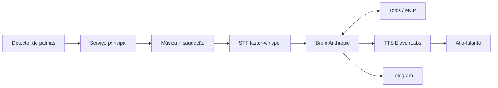

# Visão geral da arquitetura

## Fluxo

1. O detector de palmas escuta o microfone continuamente.
2. Ao detectar duas palmas seguidas, avisa o serviço principal.
3. O serviço principal toca a música de abertura e depois fala a saudação.
4. O STT grava e transcreve o comando do usuário.
5. O cérebro (API da Anthropic) decide a resposta e chama ferramentas (tools/MCP) se necessário.
6. O TTS da ElevenLabs transforma a resposta em fala, por streaming, no alto-falante.
7. Quando preciso, o cérebro envia notificações pelo Telegram (sempre com confirmação para ações externas).

## Diagrama

## Módulos e responsabilidades

- **`jarvis.trigger`** — captura do microfone e detecção de palmas duplas.
  - Saída: um evento "gatilho disparado". Não sabe nada de STT ou cérebro.
- **Serviço principal** — orquestra o ciclo; roda o gatilho como thread/task no mesmo processo.
  - Única peça que conhece todos os módulos.
- **`jarvis.stt`** — grava o comando até silêncio e transcreve localmente.
  - Entrada: áudio. Saída: texto.
- **`jarvis.brain`** — loop de conversa com a Anthropic, histórico curto, escolha de modelo (Haiku padrão, Sonnet sob demanda).
  - Entrada: texto do usuário. Saída: texto de resposta curto. Usa tools apenas pela interface de `jarvis.tools`.
- **`jarvis.tools`** — implementações das ferramentas atrás de um contrato único (nome, schema, execução); servidores MCP quando prático.
  - Ações externas passam pelo fluxo de confirmação.
- **`jarvis.tts`** — streaming de texto para fala (ElevenLabs Flash via WebSocket) e reprodução.
  - Entrada: texto. Saída: áudio no alto-falante.
- **`jarvis.interfaces`** — canais externos: Telegram agora; e-mail e telefone depois.

## Fronteiras de interface

- `trigger → serviço`: evento/callback, sem dados de áudio.
- `stt → brain`: string de texto.
- `brain → tts`: string de texto (ou stream de texto).
- `brain ↔ tools`: chamadas de ferramenta com schema; resultados são **dados**, nunca instruções.
- Configuração vem de variáveis de ambiente (`.env` local), nunca do vault.
